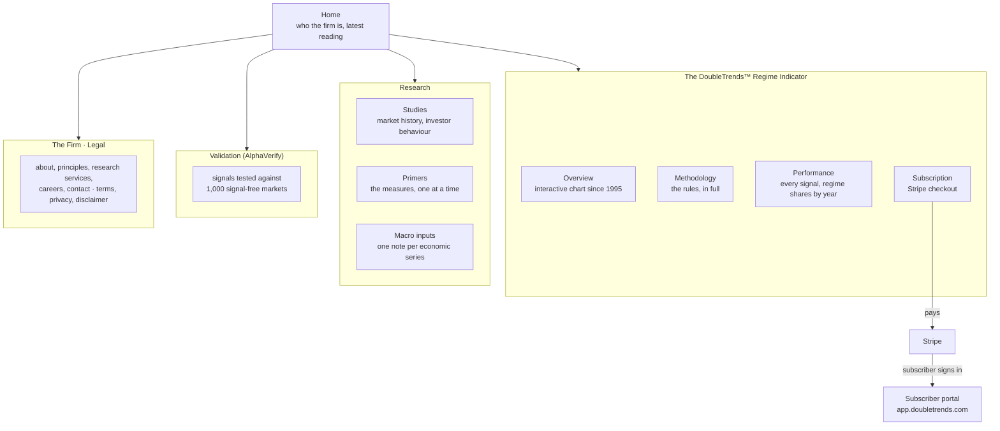
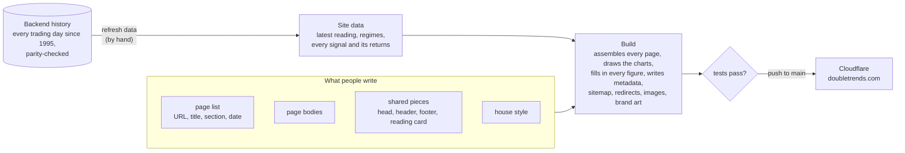
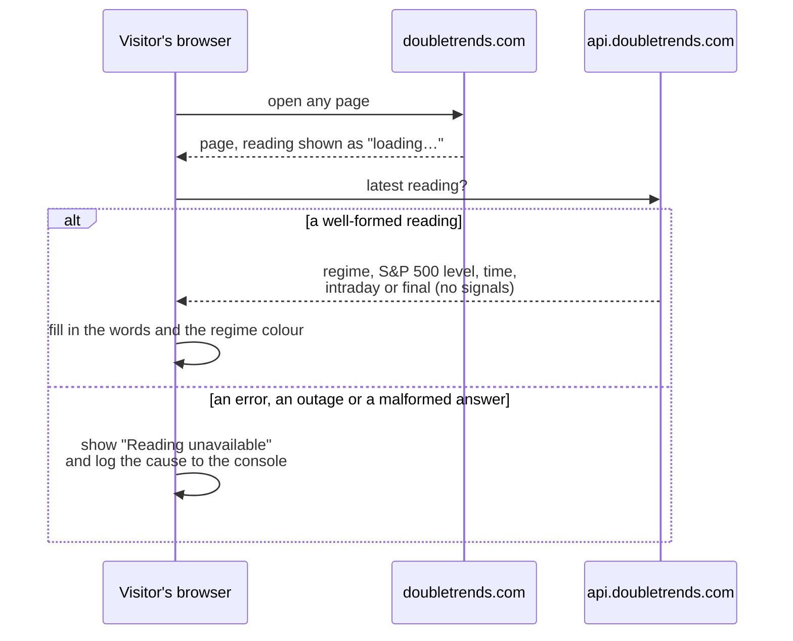

# DoubleTrends L.L.C. website

The public website of DoubleTrends L.L.C., a quantitative research firm, at **doubletrends.com**. It publishes:
- the firm's research on market regimes and drawdowns
- the **DoubleTrends™ Regime Indicator** for the S&P 500, with its full rules and record
- **AlphaVerify**, its open-source way of testing trading signals

Visitors can subscribe to the indicator here. Subscribers then use a separate portal (`app.doubletrends.com`, the `doubletrends-frontend` repo).

The site is plain HTML, CSS and a little JavaScript, assembled by one build script and served by Cloudflare. **Every number on it comes from data, never from typing.**

---

## What's on the site



---

## How it is made



Five ideas hold it together:

1. **The build is the whole system.** Everything is either an input to it or an output of it. The output is thrown away and remade every time; nobody edits it.
2. **No number is typed by hand.** Every figure, table and chart comes from the site data, which is generated from the backend's history. Refresh the data, rebuild, and every page agrees. A test fails if the data disagrees with itself.
3. **One page list rules everything about a page:**
   - its URL, title and description
   - its nav item and breadcrumb
   - its search-engine data
   - for research notes, its series and publication date

   The research library and "further reading" lists are generated from it.
4. **Every page has exactly one public address.** Cloudflare serves `/indicator/methodology`, not `methodology.html`. The site links, lists and publishes only that form, and permanently redirects the old `.html` spellings so search engines keep one address per page.
5. **Charts work without JavaScript.** Each exhibit is drawn as a static image at build time, prints cleanly, and has a table view. JavaScript only adds the crosshair, tooltips and keyboard stepping.

---

## The live reading

Almost everything is as of the last data refresh. The **regime in the top bar** and the **reading card** on the home and indicator pages are the exception: they update by themselves.



The reading refreshes hourly through the trading day and again after the close. **There is deliberately no fallback:** pages carry no built-in reading, so a broken feed shows at once instead of hiding behind an old reading. Signals stay subscriber-only.

---

## What a visit feels like

- **No font flash.** The first visit waits a moment (at most 1.2 s) for the house fonts, so text never appears in a fallback font and then jumps. After that, fonts and the stylesheet are cached long-term, so pages switch instantly.
- **Content fades up into place** as you scroll: an 8 px rise over 1 s, with whatever is on screen at load cascading in first. The top bar, header and footer never move, which a test guards. With "reduce motion" turned on in the system settings, nothing animates.
- **Leaving for checkout is announced.** Before a subscribe link opens Stripe, a short notice says where the visitor is going.

---

## House style

The site reads like an **index provider's publication**, not a product landing page:

|           |                                                                                                                                                                                                                             |
| --------- | --------------------------------------------------------------------------------------------------------------------------------------------------------------------------------------------------------------------------- |
| Type      | Source Serif 4 for headings and reading; Source Sans 3 for interface and figures                                                                                                                                            |
| Colour    | navy for text; rust only for highlights; four regime colours (Calm green, Correction ochre, Panic crimson, Bear purple), used only where they mean a regime, always labelled in words, and checked for colour-blind readers |
| Structure | ruled sections, numbered exhibits with a source line, documents with a contents column; archival photographs, no stock imagery                                                                                              |
| Voice     | plain and specific; every figure with its basis. Anything before 15 June 2026 (first live publication) is labelled **back-tested**, and the full signal record is always published                                          |
| Name      | never bare: the company is **DoubleTrends L.L.C.**, the product mark is **DoubleTrends™**, and every page carries the trademark notice once                                                                                 |

The brand lives here. The logo, wordmark, favicons, social images and engraved-paper backgrounds are all generated by the build. The footer's banknote frame (a lathe ribbon with a lens chain woven through it, and a medallion in each corner) is drawn in the browser to the footer's exact size, so its corners keep their shape at every width. The subscriber portal copies the colours, fonts and logo from this repo.

---

## What the tests guard

`npm test` builds the site, then checks the result. CI runs the same, and nothing deploys unless every check passes.

| Area          | Guarantees                                                                                                   |
| ------------- | ------------------------------------------------------------------------------------------------------------ |
| Links         | every internal link, anchor, image and download exists, in the form Cloudflare serves directly               |
| Addresses     | canonical tags, sitemap and redirects use only real public addresses                                         |
| Metadata      | every page has its title, description and social tags, in the house convention                               |
| Page list     | entries are complete and consistent; research notes are in a known series                                    |
| Search data   | structured data parses and fits each page type                                                               |
| Labels        | section names, kickers and the highlighted nav item agree across pages                                       |
| Name          | the trademark convention holds everywhere                                                                    |
| Data          | the reading, the daily history and the signal download agree with one another                                |
| Brand colours | the stylesheet's colours match the brand definition                                                          |
| Profiles      | the firm's profiles elsewhere (LinkedIn and others, kept in `LISTING.md`) fit their forms and match the site |
| Motion        | blocks reveal whole, the header and footer never move, and every page has the guard                          |
| Live reading  | every page has the hooks, no reading is built into a page, and a broken feed has its own "unavailable" words |

The build itself also fails if any page is left with an unfilled `{{placeholder}}`.

---

## Working on it

```bash
npm run build            # build the site
npm run dev              # build and serve locally
npm test                 # build, then run every check (what CI runs)

npm run indicator-data   # refresh the data from ../doubletrends-backend (after it rebuilds history)
npm run archive-images   # fetch the archival photographs (needs the network)
```

The site data and archival photographs can't be made in CI, because they need the backend's files or the network. So they're committed, and refreshed by hand.
