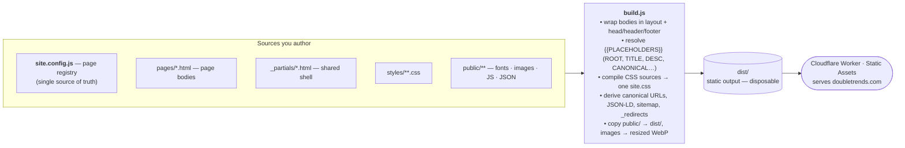

# DoubleTrends™ Site

Marketing site for DoubleTrends™, served at `doubletrends.com`.

Static HTML/CSS/JS — no framework. A single Node.js build step (`build.js`) assembles pages from templates, derives all metadata, compiles the stylesheet, and optimizes images; the output in `dist/` is deployed as a Cloudflare Worker (Static Assets).

---

## The big picture

Read this first — it's the whole repo in one screen.

This is a **tiny static-site generator**, not a framework app. There is no client-side router, no bundler, no app shell. `build.js` runs at build time, produces plain HTML/CSS/JS into `dist/`, and Cloudflare serves it. That's the entire runtime.



Five load-bearing ideas — internalize these and the rest is detail:

1. **`build.js` is the whole system.** Everything below is an input to it or an output from it.
2. **The page registry (`src/site.config.js`) is the single source of truth.** Page files under `src/pages/` are just body content; their title, description, URL, JSON-LD kind, sitemap priority, and robots rules all live in the registry entry, not in the page.
3. **URLs and metadata are derived once, never hand-authored twice.** The canonical URL, sitemap `<loc>`, `_redirects` targets, JSON-LD, and Open Graph all flow from one helper (`canonicalFor` in `src/schema.js`), so they cannot drift. See [URLs, serving & SEO](#urls-serving--seo).
4. **Assets are transformed, not just shipped.** CSS sources compile to one file; images are resized and converted to WebP at build time while the editable originals stay in `public/`. See [Image pipeline](#image-pipeline).
5. **`dist/` is disposable.** It is generated output — never edit it, never link to a `.html` file inside it.

---

## Quick start

```bash
npm run build     # build the site into dist/
npm run dev       # build once, then serve dist/ locally at http://localhost:8787
npm run deploy    # build, then deploy with Wrangler (manual fallback — see Deployment)
npm test          # run the full validation suite
```

Data and brand regeneration (run only when their inputs change):

```bash
npm run replay-data   # rebuild replay JSON in public/replay/ (needs the backend repo — see below)
npm run brand         # regenerate logos/favicons/OG image in public/brand/
```

### Where to look first

| You want to… | Start here |
| --- | --- |
| Add or edit a page's metadata/URL | `src/site.config.js` (the page registry) |
| Change a page's content | `src/pages/<path>.html` |
| Author a brand-new page | copy a scaffold from `src/_templates/`, then register it |
| Change shared header/footer/head | `src/_partials/` |
| Change styling | `src/styles/` (tokens → base → components → layouts) |
| Understand the build | `build.js` (top-to-bottom, it's linear) |

---

## Deployment

Deploys are **gated by CI**. A push to `main` triggers `.github/workflows/ci.yml`: the `test` job runs the full validation suite, and only if it passes does the `deploy` job build and `wrangler deploy` to `doubletrends.com`. Broken code cannot reach production.

The `deploy` job needs two repo secrets — `CLOUDFLARE_API_TOKEN` and `CLOUDFLARE_ACCOUNT_ID` — and Cloudflare's own Git auto-deploy must be **disabled** so CI is the only deploy path (otherwise the site deploys twice, ungated).

`npm run deploy` (`node build.js` → `wrangler deploy`) remains a manual local fallback. `dist/` is the Worker's asset directory (`wrangler.jsonc`).

Production routing is declared in `wrangler.jsonc`, not only in the dashboard: the `routes` entry binds `doubletrends.com` as a custom domain. Before it was added, deploys ended with `No targets deployed for doubletrends` and the site served only because the domain had been attached by hand — so a recreated Worker would have come up with no domain and nothing in the repo explaining why.

---

## How the build works

`build.js` runs top-to-bottom and is deliberately linear. In order, it:

1. Reads shared partials from `src/_partials/` (layout, head, header, footer, checkout gate, stories).
2. Compiles the CSS sources in `src/styles/` into one minified `dist/public/css/site.css` via the Tailwind CLI.
3. For each entry in the page registry, reads the body from `src/pages/`, wraps it in `layout.html`, and injects head/header/footer.
4. Resolves placeholders — `{{ROOT}}`, `{{TITLE}}`, `{{DESC}}`, `{{CANONICAL}}`, `{{STORIES}}`, and more.
5. Rewrites internal `.html` hrefs to the extensionless URLs Cloudflare serves with 200 (`method.html` → `method`, `academy/index.html` → `academy/`). Templates author plain `.html` paths.
6. Auto-tags top-level blocks with `data-reveal` for the scroll-reveal motion system (see [Motion](#motion)).
7. Writes final HTML to `dist/` and generates `sitemap.xml`, `_redirects`, and `llms.txt`.
8. Copies `public/` into `dist/public/`, re-encoding the managed images to resized WebP along the way (see [Image pipeline](#image-pipeline)).

### Templates vs. partials vs. scaffolds — don't confuse them

- **`src/_partials/`** — shared fragments injected into *every* build (`layout.html` is the page shell with `{{HEAD}}`/`{{HEADER}}`/`{{CONTENT}}`/`{{FOOTER}}` slots; plus `head`, `header`, `footer`, `checkout-gate`, `stories`, `routing-card`). These are build inputs.
- **`src/_templates/`** — authoring **scaffolds** you *copy* to start a new page (`article`, `company`, `directory`, `legal`). They are **not** read by the build; they carry `<!-- FILL: -->` markers and a reminder to register the page.
- **`src/pages/`** — the actual page bodies, one file per page.

---

## Repo layout

### Directories

- `src/pages/` — page bodies (content only), one file = one page = one URL.
- `src/_partials/` — shared layout, head, header, footer, and reusable fragments injected by the build.
- `src/_templates/` — copy-to-create scaffolds for new pages (not build inputs).
- `src/styles/` — CSS sources, layered `tokens/` → `base/` → `components/` → `layouts/`, concatenated and compiled by `build.js` into one `site.css`.
- `public/` — static assets copied into the build: fonts, images, replay JSON, and browser JS.
- `dist/` — generated output. Treat as a build artifact; never edit or commit-link it.

### `public/js/`

Site-wide (loaded on every page via `layout.html`):

- `accordion.js` — `<details>` accordion animation.
- `canvas-grid.js` — animated square grid decorating section banners.
- `scroll-reveal.js` — drives the `data-reveal` fade-up motion the build tags onto blocks.

Loaded only where needed:

- `checkout-gate.js` — the subscribe/checkout gate (via the `checkout-gate` partial).
- `story-strip.js` — story carousel (via the `stories` partial).
- `replay-chart.js`, `history-table.js`, `lightweight-charts.standalone.production.js` — homepage replay chart + signal history table (loaded by `index.html`; the charts library is vendored).

### Key files

- `build.js` — the site build (assemble, compile CSS, derive metadata, optimize images, emit `dist/`).
- `build-images.js` — image optimization step used by `build.js` (resize + WebP; see below).
- `build-brand.js` — regenerates brand assets into `public/brand/`.
- `build-replay-data.js` — rebuilds `public/replay/*.json` from backend artifacts.
- `src/site.config.js` — page registry and site-level config (source of truth).
- `src/schema.js` — canonical-URL and JSON-LD helpers.
- `src/brand.config.js` — brand token source of truth (colors, fonts).
- `wrangler.jsonc` — Cloudflare deploy config; serves `dist/` as Worker assets and declares the `doubletrends.com` custom domain.

---

## URLs, serving & SEO

This ties together file output, how Cloudflare serves it, and what we publish to crawlers. Getting it wrong reintroduces Google Search Console "Page with redirect" errors, so it is documented in full.

Every page has three distinct identities. Keep them separate:

| Identity | Example (for "method") | Where it lives |
| --- | --- | --- |
| **Source of truth** (file) | `dist/method.html` | build output only — never linked or published |
| **Canonical URL** (served 200) | `/method` | canonical tag, sitemap, llms.txt, JSON-LD, Open Graph, internal links |
| **Alternate spellings** | `/method.html`, `/method/` | only as `_redirects` sources → redirect to the canonical |

### Source of truth

Pages are authored as `.html` files under `src/pages/` and emitted **flat** to `dist/` — `method.html` → `dist/method.html`. One source file = one page = one URL. `src/site.config.js` and `tests/test-page-registry.js` mirror this so `rootFor` derives `{{ROOT}}` depth from the same path.

> Do **not** emit pages as `<slug>/index.html`. That was tried (commit `90032ff`) on the assumption Cloudflare would serve `/method` directly with 200. It does not — see below.

### What Cloudflare actually does

Cloudflare (Workers Static Assets) serves each asset at **one** canonical URL and **redirects every other spelling to it**:

- A `.html` file is served at its **extensionless** URL with a **200**. The `.html` URL itself **always redirects**.
- A `<dir>/index.html` file is served at `/<dir>/` (trailing slash) with a **200**. `/dir` (no slash) redirects to `/dir/`.

So the canonical served form is: leaf page `foo.html` → `/foo` (no slash); directory index `dir/index.html` → `/dir/` (slash); root `index.html` → `/`.

This is the platform default (`auto-trailing-slash` HTML handling), not something we configure. See [Workers Static Assets · HTML handling](https://developers.cloudflare.com/workers/static-assets/routing/advanced/html-handling/). This repo deploys as a **Worker (Static Assets)**, whose built-in redirects are **307 (temporary)** — verified by curling `/404.html` (excluded from `_redirects`), which returns `307 → /404`.

### `canonicalFor()` — one source for every URL we publish

`canonicalFor(siteUrl, src)` in `src/schema.js` computes the canonical served URL from a source path (strip `index.html`, then `.html`). It is the **single source** feeding the canonical tag, `sitemap.xml` `<loc>`, `llms.txt` links, JSON-LD, and `_redirects` targets — so they cannot drift. The published URL is always the served-200 form, **never the `.html` path**.

### `_redirects` — a 307 → 301 upgrade, not a router

`build.js` generates `dist/_redirects` mapping every legacy `.html` (and `index.html`) URL to its canonical form with a **301**. This does not *create* the redirect — Cloudflare already redirects `.html` natively — it **upgrades** it from 307 (temporary) to 301 (permanent), so Google drops the `.html` URL and consolidates ranking signals. `404.html` is deliberately excluded (it's `noindex`, so permanence is irrelevant, and it stays a clean control still showing the native 307).

### What each URL form does

**301** = our `_redirects` (permanent). **307** = Cloudflare native (temporary), only ever hit on forms we never link or publish.

| Type | Source file | Canonical (200) | `.html` form | wrong-slash / `index.html` form |
| --- | --- | --- | --- | --- |
| **Root** | `index.html` | `/` | `/index.html` → **301** → `/` | — |
| **Section index** | `academy/index.html` | `/academy/` | — | `/academy` → **307** → `/academy/`; `/academy/index.html` → **301** → `/academy/` |
| **Leaf page** | `method.html` | `/method` | `/method.html` → **301** → `/method` | `/method/` → **307** → `/method` |

A slash means "collection," no slash means "document." That split is correct, not an inconsistency.

---

## Page registry

`src/site.config.js` defines the `pages` array — the source of truth for every page's output path, kind, title/description, sitemap inclusion and priority, robots behavior, and optional schema/routing-card content.

It is helper-driven to cut boilerplate and drift. All helpers derive `root` automatically via `rootFor(src)` and take an `overrides` object for page-specific fields:

| Helper | `src` becomes | Default `kind` | Default `priority` |
| --- | --- | --- | --- |
| `page(src, o)` | the string you pass (`method.html`) | `webpage` | `0.7` |
| `article(slug, o)` | `academy/${slug}.html` | `article` | `0.7` |
| `companyPage(slug, o)` | `company/${slug}.html` | `webpage` | `0.5` |
| `legalPage(slug, o)` | `legal/${slug}.html` | `webpage` | `0.3` |

```js
article('vix-percentile', {
  title: 'What Is VIX Percentile? Reading Volatility Against Itself',
  desc: '…',
  schema: { articleSection: 'Volatility', about: ['S&P 500 index', 'volatility'] },
});
```

`rootFor(src)` derives the relative path back to the site root (`index.html` → `''`, `academy/index.html` → `'../'`), keeping shared-partial links working from nested directories without repeating `root` on every entry.

The `<title>` pattern `DoubleTrends™ | {page.title}` is applied centrally in `build.js`, so registry `title` fields hold only the page-specific portion.

---

## Image pipeline

`build-images.js` replaces the old verbatim `public/` copy. It copies everything unchanged **except** a manifest of managed rasters, which it re-encodes to **resized WebP** sized to ~2× their largest on-screen dimension. Images reused in the 320px stories carousel also get a small `-card.webp` thumbnail, so a full hero shot is never shipped into a thumbnail slot.

- **Manifest** — each entry sets a `maxWidth`, a `quality` (charts/screenshots 82–84; hero decor behind a tint 72–76; flat diagrams use lossless WebP, which beats lossy on them), and an optional `thumb` flag.
- **Originals stay editable** in `public/`; WebP is generated into `dist/` at build time. Nothing pre-optimized is committed.
- **Adding an image:** drop the source in `public/`, add a manifest line in `build-images.js`, and reference it by its `.webp` name in the page. `tests/test-links.js` verifies every referenced asset exists in `dist/`.
- **Left as-is:** brand assets (`og-image`, `wordmark`, `banner`, favicons) stay PNG for social-scraper compatibility; SVGs stay vector.

---

## Motion

The build tags top-level content blocks with `data-reveal`; `public/js/scroll-reveal.js` fades them up on scroll (and cascades the first viewport on load). Blocks reveal as a whole — the build strips `data-reveal` from any nested descendant so nothing double-animates. A block that already carries `data-reveal` by hand is left untouched. See the reveal logic in `build.js` and its contract test `tests/test-reveal-contract.js`.

---

## Replay data

The homepage replay chart and history table read from `public/replay/`, produced by `build-replay-data.js`:

- `public/replay/sp500.json` — OHLC candles plus regime/watch/setup/signal state and authoritative signal dates.
- `public/replay/history.json` — signal history entries with forward-return snapshots.

The replay build is intentionally coupled to the backend repo so the site displays the same signal history the backend produces.

---

## Brand assets

Brand assets are generated, not hand-drawn.

- Generator: `build-brand.js` → output in `public/brand/` → frontend tokens in `src/brand.config.js`.
- Do **not** hand-edit generated SVG/PNG in `public/brand/`; regenerate with `npm run brand`.

---

## Backend relationship

Site-only, but it depends on data artifacts from the sibling backend repo.

- Expected sibling path: `../doubletrends-backend`
- Replay-data input CSV: `../doubletrends-backend/signal/backfill/fast/backfill_fast.csv`

If `doubletrends-backend` is missing or stale, `npm run replay-data` can fail or produce outdated demo data.

---

## Nav bar glass effect

The nav bar's frosted-glass look comes from a `::before` pseudo-element, **not** `backdrop-filter` on `<header>` itself. Applying `backdrop-filter` directly to the header makes it a backdrop root, which breaks the dropdown panel's own `backdrop-filter`. Delegating the blur to `::before` keeps the header from being a backdrop root, so the dropdown composites independently.

- Nav blur: `.site-header::before` in `src/styles/components/nav-base.css`
- Dropdown blur: `.nav-dropdown-panel` (same file)
- Header inline style: shadow only — no `backdrop-filter`

---

## Tests

`npm test` runs the full validation suite (build + link/metadata/schema/registry/consistency checks). See [`tests/README.md`](tests/README.md) for individual commands and the contract each test enforces.

## Reading map

- Site/page registry: `src/site.config.js`
- Structured data & canonical helpers: `src/schema.js`
- Brand tokens: `src/brand.config.js`
- Build pipeline: `build.js` · image step: `build-images.js`
- Brand asset generator: `build-brand.js`
- Replay artifact generator: `build-replay-data.js`
