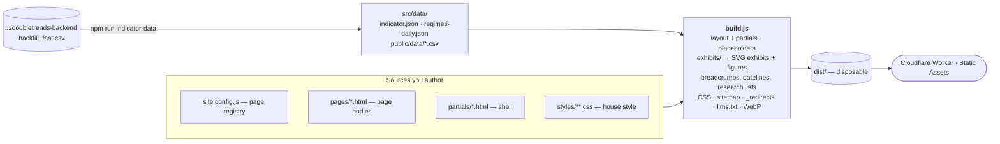

# DoubleTrends Site

Public site of DoubleTrends, served at `doubletrends.com`. The site presents a quantitative research firm: research notes, the DoubleTrends Regime Indicator as public research (overview, methodology, historical data, subscriber access), research services, and the firm pages. Navigation: Research · Indicator · Methodology · Data · Services · About. The rules and record are public; the subscription pays for timely delivery and is described as priced close to its running cost. The founder acts on the signal with their own capital.

Static HTML/CSS/JS — no framework. A single Node.js build (`scripts/build.js`) assembles pages, renders the data exhibits, derives all metadata, compiles the stylesheet and optimizes images; `dist/` is deployed as a Cloudflare Worker (Static Assets).

---

## The big picture



Load-bearing ideas:

1. **The build (`scripts/build.js` and its `build-*.js` steps) is the whole system.** Everything else is an input to it or an output of it.
2. **No number is typed by hand.** Every figure on the site — the latest reading, signal counts, returns, regime shares, the exhibits — comes from `src/data/`, generated from the backend's validated backfill by `scripts/indicator-data.js`. Change the data, rebuild, and every page agrees.
3. **The page registry (`src/site.config.js`) is the single source of truth** for each page's URL, title, description, nav item, breadcrumb, JSON-LD and — for research notes — section, series and publication date. The research library and "further reading" blocks are generated from it.
4. **URLs and metadata are derived once** (`src/urls.js`) and feed the canonical tag, sitemap, `_redirects`, JSON-LD and Open Graph. See [URLs, serving & SEO](#urls-serving--seo).
5. **`dist/` is disposable.** Never edit it.

---

## Quick start

```bash
npm run build            # build into dist/
npm run dev              # build, then serve dist/ with Wrangler
npm test                 # full validation suite (what CI runs)
npm run deploy           # manual fallback — CI deploys on push to main
```

Regenerate inputs only when they change:

```bash
npm run indicator-data   # src/data/ + public/data/ from ../doubletrends-backend (after a backend backfill)
npm run archive-images   # public/img/archive/ from src/data/archive-images.json (needs the network)
```

### Where to look first

| You want to…                                        | Start here                                                          |
| --------------------------------------------------- | ------------------------------------------------------------------- |
| Change a page's title, description, URL or nav item | `src/site.config.js`                                                |
| Change a page's content                             | `src/pages/<path>.html`                                             |
| Add a research note                                 | copy `src/templates/article.html`, register it with `article(...)`  |
| Change a figure, table or exhibit                   | `src/exhibits/` (fed by `src/data/`)                               |
| Change the header, footer or head                   | `src/partials/`                                                     |
| Change styling                                      | `src/styles/` (tokens → base → components → layouts → legacy)       |

---

## Layout

| Folder | Holds | Tracked |
| --- | --- | --- |
| `src/` | page bodies (`pages/`, one `.html` per URL), page registry, schema, exhibits, partials, templates, styles, `data/` the build reads | yes |
| `public/` | files served as-is under `/public/` (fonts, scripts, images, the signal CSV) | yes |
| `scripts/` | the build and the generators run by hand | yes |
| `tests/` | the validation suite | yes |
| `build/` | downloads and temp files on the way to `dist/` | no |
| `dist/` | the deployed site | no |

Generated files that can't be built in CI (they need the backend or the network) are committed and listed in `.gitattributes` with their generator: `src/data/*` except `archive-images.json`, `public/data/`, `public/img/archive/`.

---

## Deployment

Deploys are **gated by CI**. A push to `main` runs `.github/workflows/ci.yml`: the `test` job runs the full suite, and only if it passes does `deploy` build and `wrangler deploy` to `doubletrends.com`. It needs the repo secrets `CLOUDFLARE_API_TOKEN` and `CLOUDFLARE_ACCOUNT_ID`; Cloudflare's own Git auto-deploy must stay **disabled** so CI is the only deploy path.

Production routing is declared in `wrangler.jsonc` (`routes` binds `doubletrends.com` as a custom domain), so a recreated Worker comes up with its domain attached.

Readings on the site are as of the last build (the date is printed beside them). Refreshing them means: backend backfill → `npm run indicator-data` → commit → push.

---

## How the build works

`scripts/build.js` only runs the steps, in this order; each lives in its own file:

| Step | File | Does |
| --- | --- | --- |
| 1 | `src/exhibits/` | computes figures and exhibits once from `src/data/` |
| 2 | `build-css.js` | compiles `src/styles/` into one minified `dist/public/styles/site.css` (Tailwind CLI; utilities remain available to older page markup) |
| 3 | `build-pages.js` | for each registry entry: wraps the body from `src/pages/` in `layout.html` with the partials, resolves every placeholder (**fails the build on any left over**), marks the current nav item, decorates research notes (breadcrumb, dateline, further reading from `build-listings.js`), stripes sections, and rewrites internal `.html` links to the extensionless URLs Cloudflare serves with 200 |
| 4 | `build-urls.js` | `sitemap.xml` and `_redirects` from the registry |
| 5 | `build-llms.js` | `llms.txt` from its template in `src/` |
| 6 | `build-images.js`, `build-guilloche.js`, `build-brand.js` | copies `public/`, re-encoding managed images to WebP; generates the guilloche patterns and brand assets into `dist/public/brand/` |

`scripts/placeholders.js` holds the `{{NAME}}` mechanism every step shares. `scripts/indicator-data.js` and `scripts/archive-images.js` are not build steps: they are run by hand (`npm run indicator-data`, `npm run archive-images`) and write committed files.

Placeholder families: `ROOT`, `TITLE`, `DESC`, `CANONICAL` … (page metadata), `SITE_NAME`, `LEGAL_NAME`, `EMAIL`, `SUBSCRIBE_URL` … (site facts, `SITE_VARS` in `scripts/placeholders.js`, also in `llms.txt`), `BREADCRUMB`, `RESEARCH_RECENT` / `RESEARCH_LIBRARY`, `IND_*` (latest reading, history span), `SIG_*` (signal record), `MDD_*` (drawdown study), `EXHIBIT_*` and `TABLE_*` (SVG exhibits, data tables), each written in double braces in page markup. The full list is the return value of `buildExhibits()` in `src/exhibits/index.js`.

### Partials vs. templates

- **`src/partials/`** — markup the build injects, read with `partial()` (`scripts/placeholders.js`). In every page: `layout`, `head`, `header` (utility bar with the latest reading + primary nav), `footer` (disclosures, trademark notice), `checkout-gate` (notice shown before Stripe checkout). Where a page needs them: `reading-card` + `reading-link`, `splash` (archival image hero and band), and for research notes `article-meta` (dateline) and `further-reading`; `footer-more` is the footer's notes toggle. The small scripts inlined with them are `splash-fit.js` and `footer-more.js`. Every word the build adds to a page is in one of these files.
- **`src/templates/`** — copy-to-create scaffolds (`article`, `legal`), not read by the build.

---

## House style

The site is designed to read like an index provider's publication, not a product landing page.

- **Type:** Source Serif 4 for headings and long-form reading, Source Sans 3 for interface and data (tabular figures in tables). Self-hosted latin subsets, SIL OFL (`public/fonts/*/OFL.txt`).
- **Color:** the brand's two colors from the original wordmark — navy `#2A3340` for text and chrome, rust `#C2410C` for highlights only (kickers, active nav, accent rules, "Double" in the wordmark, and signal markers on the exhibits). The four regime colors (`--regime-*`: calm green, correction yellow, panic crimson, bear purple) appear only where they encode a regime and are kept clear of rust — panic is magenta, not red, so it is never confused with the brand accent. The palette was validated for color-vision deficiency (all regime pairs CVD ΔE ≥ 8.4, normal ≥ 18.1; each ≥ 16.4 from rust); the ochre is below 3:1 on white, so regimes are always labelled in text and every exhibit has a table view.
- **Structure:** ruled sections, numbered exhibits with a source line, document pages with a contents column. No cards, shadows, gradients, scroll animation or stock photography.
- **Voice:** sentence case, plain and specific, figures with their basis. Readings before the live date are always labelled **back-tested**; the full signal record, including early signals, is always published.
- **Trademark:** `DoubleTrends` in running text; the ™ appears in the footer notice and the legal documents (enforced by `tests/test-trademark.js`).

### Styles (`src/styles/`)

| File | Role |
| --- | --- |
| `tokens/colors.css`, `tokens/font-face.css` | palette (mirror of `src/brand.config.js`) and faces |
| `base/reset-global.css`, `base/type-base.css` | reset, type scale, prose |
| `components/chrome.css` | utility bar, masthead, nav, breadcrumb, footer |
| `components/controls.css` | buttons |
| `components/exhibit.css` | exhibits, legends, tooltips, data tables |
| `layouts/document.css` | page heads, reading panel, key figures, sections, contents layout, entries, facts, steps, notes, offer |
| `components/legacy.css` | maps the class vocabulary inside older research notes and legal documents onto the house style |

---

## Data and exhibits

`scripts/indicator-data.js` reads `../doubletrends-backend/signal/backfill/fast/backfill_fast.csv` — the point-in-time history produced and parity-checked by the backend's `python -m backfill.prod` — and writes:

- `src/data/indicator.json` — latest reading, regime statistics, bear episodes, every signal with 3-month / 1-year / 2-year S&P 500 price returns, and the summary figures. Build input.
- `src/data/regimes-daily.json` — `[date, close, regime]` for every classified trading day. Build input; not shipped.
- `public/data/doubletrends-signals.csv` — the public signal history download.

Constants at the top of the script: `LIVE_SINCE` (first live publication date; earlier readings are labelled back-tested) and `SIGNAL_RECORD_START` (the published record includes every signal from this date).

`src/exhibits/` renders the exhibits to static SVG at build time (they work without JavaScript and print cleanly); `public/scripts/exhibits.js` adds the crosshair and tooltips, with keyboard stepping and a live region for screen readers.

## URLs, serving & SEO

This ties together file output, how Cloudflare serves it, and what we publish to crawlers. Getting it wrong reintroduces Google Search Console "Page with redirect" errors, so it is documented in full.

Every page has three distinct identities. Keep them separate:

| Identity | Example (for "method") | Where it lives |
| --- | --- | --- |
| **Source of truth** (file) | `dist/indicator/methodology.html` | build output only — never linked or published |
| **Canonical URL** (served 200) | `/indicator/methodology` | canonical tag, sitemap, llms.txt, JSON-LD, Open Graph, internal links |
| **Alternate spellings** | `/indicator/methodology.html`, `/indicator/methodology/` | only as `_redirects` sources → redirect to the canonical |

### Source of truth

Pages are authored as `.html` files under `src/pages/` and emitted to `dist/` at their source path — `indicator/methodology.html` → `dist/indicator/methodology.html`. One source file = one page = one URL. `src/site.config.js` and `tests/test-page-registry.js` mirror this so `rootFor` derives `{{ROOT}}` depth from the same path.

> Do **not** emit pages as `<slug>/index.html`. That was tried (commit `90032ff`) on the assumption Cloudflare would serve `/method` directly with 200. It does not — see below.

### What Cloudflare actually does

Cloudflare (Workers Static Assets) serves each asset at **one** canonical URL and **redirects every other spelling to it**:

- A `.html` file is served at its **extensionless** URL with a **200**. The `.html` URL itself **always redirects**.
- A `<dir>/index.html` file is served at `/<dir>/` (trailing slash) with a **200**. `/dir` (no slash) redirects to `/dir/`.

So the canonical served form is: leaf page `foo.html` → `/foo` (no slash); directory index `dir/index.html` → `/dir/` (slash); root `index.html` → `/`.

This is the platform default (`auto-trailing-slash` HTML handling), not something we configure. See [Workers Static Assets · HTML handling](https://developers.cloudflare.com/workers/static-assets/routing/advanced/html-handling/). This repo deploys as a **Worker (Static Assets)**, whose built-in redirects are **307 (temporary)** — verified by curling `/404.html` (excluded from `_redirects`), which returns `307 → /404`.

### `src/urls.js` — one source for every URL we publish

`extensionless()` in `src/urls.js` turns a source path into its served form (strip `index.html`, then `.html`); `canonicalPath(src)` and `canonicalFor(src)` build on it. It is the **single source** feeding the canonical tag, `sitemap.xml` `<loc>`, `llms.txt` links, JSON-LD, breadcrumbs, `_redirects` targets and the internal links in built pages — so they cannot drift. The published URL is always the served-200 form, **never the `.html` path**.

### `_redirects` — a 307 → 301 upgrade, not a router

`scripts/build-urls.js` generates `dist/_redirects` mapping every legacy `.html` (and `index.html`) URL to its canonical form with a **301**. This does not *create* the redirect — Cloudflare already redirects `.html` natively — it **upgrades** it from 307 (temporary) to 301 (permanent), so Google drops the `.html` URL and consolidates ranking signals. `404.html` is deliberately excluded (it's `noindex`, so permanence is irrelevant, and it stays a clean control still showing the native 307).

### What each URL form does

**301** = our `_redirects` (permanent). **307** = Cloudflare native (temporary), only ever hit on forms we never link or publish.

| Type | Source file | Canonical (200) | `.html` form | wrong-slash / `index.html` form |
| --- | --- | --- | --- | --- |
| **Root** | `index.html` | `/` | `/index.html` → **301** → `/` | — |
| **Section index** | `research/index.html` | `/research/` | — | `/research` → **307** → `/research/`; `/research/index.html` → **301** → `/research/` |
| **Leaf page** | `indicator/methodology.html` | `/indicator/methodology` | `/indicator/methodology.html` → **301** → `/indicator/methodology` | `/indicator/methodology/` → **307** → `/indicator/methodology` |

A slash means "collection," no slash means "document." That split is correct, not an inconsistency.

---


## Page registry

`src/site.config.js` defines `pages`. Helpers derive `root` from the path and take overrides:

| Helper | `src` | Defaults |
| --- | --- | --- |
| `page(src, o)` | as given | `kind: 'webpage'`, priority 0.7 |
| `article(slug, { published, ... })` | `research/${slug}.html` | `kind: 'article'`, `nav: 'research'`; `published` → dateline + JSON-LD `datePublished` |
| `companyPage(slug, o)` | `company/${slug}.html` | `nav: 'about'`, priority 0.5 |
| `legalPage(slug, o)` | `legal/${slug}.html` | priority 0.3 |

Research notes also set `section` (topic, shown as "Research · {section}") and `series` (`Studies`, `Primers`, `Macro inputs`), which group the library. Titles render as `{page.title} | DoubleTrends`; the homepage as `DoubleTrends — {title}`.

---

## Image pipeline

`scripts/build-images.js` copies `public/` unchanged except a manifest of research-note figures, which it re-encodes to resized WebP (≈2× their on-screen width; lossless for flat diagrams). Reference images by their `.webp` name; `tests/test-links.js` verifies every referenced asset exists. Brand assets stay PNG/SVG.

---

## Brand assets

`scripts/build-brand.js`, called by the build, generates `dist/public/brand/`: the portico mark (two pilasters and a rust threshold, with no background; on a navy tile only for favicons, and as a navy and a white avatar for social profiles) and the two-tone wordmark ("Double" rust, "Trends" navy) set in Source Serif 4 and converted to outlines (no font dependency), favicons, and the OG image, the banner and the LinkedIn company-page cover (`linkedin-banner.png`, 1128 × 191 at 2×): navy cards under the paper moiré of `scripts/build-guilloche.js`, with an archival photo (`OG_PHOTO`, its `card` rendition) fading in on the right. Every historical filename is still produced so external links keep working. Nothing in it is committed.

---

## Tests

`npm test` builds and runs the suite: links, trademark convention, metadata, page registry, JSON-LD schema, label consistency (kickers, research sections, About index, nav state) and brand-token mirrors. See [`tests/README.md`](tests/README.md).

## Reading map

- Page registry: `src/site.config.js` · canonical URLs and breadcrumbs: `src/urls.js` · structured data: `src/schema.js`
- Figures and exhibits: `src/exhibits/` · calculations (drawdowns, declines, regime episodes): `src/measures.js` · data generator: `scripts/indicator-data.js`
- Brand tokens: `src/brand.config.js` · brand generator: `scripts/build-brand.js`
- Build: `scripts/build.js` (steps in `scripts/build-*.js`) · placeholders: `scripts/placeholders.js`
- Formatting of dates and numbers: `src/format.js` · regimes (order, code, label, definition, signal eligibility): `src/regimes.js`; their colors: `REGIME_COLORS` in `src/brand.config.js`
- Site sections and research series: `SECTIONS`, `SERIES` in `src/site.config.js`
- The firm's profiles elsewhere (GitHub, LinkedIn, Crunchbase, Wellfound, Product Hunt), ready to paste: [`LISTING.md`](LISTING.md)
